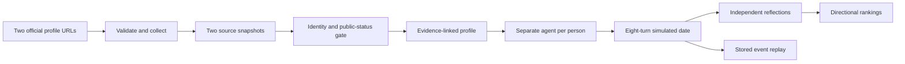

# Three-hour delivery plan

This is an execution plan for the specification, not a record of completed implementation. Start the clock when building begins. A working Apify account, a model API credential, hosting access, GitHub publication access, and a YouTube upload path are prerequisites. The supplied task gives a three-hour total; it does not guarantee that acquiring these services, verifying accounts, or scraping platforms will fit it.

## Order of work

| Build time | Work | Required observable result |
| --- | --- | --- |
| 0–15 min | Test both collection adapters on two candidate pairs; inspect actual output schema, source provenance, private flags, and identity evidence | Two successful source-backed imports, or an explicit feasibility failure |
| 15–35 min | Persist imports, source snapshots, evidence, and profiles; start collecting a reserve pool | A browser can paste links and open two truthful analyzed profiles |
| 35–60 min | Implement durable worker, isolated agent turns, reflections, and rankings | A real two-person date runs end to end, survives reload, and links to both assessments |
| 60–80 min | Build cohort/profile/date/ranking screens; run three-person integration checks | Three actual pairwise dates and complete per-person rankings |
| 80–120 min | Admit 25 verified people, freeze the cohort, execute all 300 dates; inspect errors while improving UI | All pairs are tracked; no guessed or private accounts are admitted |
| 120–140 min | Finish failed pairs, validate provenance/cardinalities, test fresh-link imports and mobile UI | 25 profiles, 300 completed dates, 600 assessments, 25 lists of 24 |
| 140–155 min | Deploy persistent web/worker/database, publish sanitized code, open demo in a fresh session | Working HTTPS live/demo URLs and public GitHub URL |
| 155–175 min | Record, trim, narrate/caption, and upload the video | A watchable YouTube link, duration ≤180 seconds |
| 175–180 min | Check every submission field and public URL | Submitted fields refer to the same finished run |

Start data acquisition as early as possible and let it run while implementing the vertical slice. Once source feasibility is demonstrated, use the same adapters in the UI. Preserve the final 25-minute recording/upload window. Cut optional imagery, sophisticated visual effects, extra date phases, and ancillary dashboards before cutting the live import, truthful profiles, actual agent interactions, or complete rankings.

If fewer than 25 verified source pairs are available by minute 80, the full submission is at risk. Expand the candidate reserve and report the count accurately. Do not synthesize profiles or silently relax public-status checks. If provider latency makes 300 completed dates impossible within the remaining window, report the incomplete run; the task's wording does not establish that a selectively dated subset passes.

## Workload and capacity

For 25 people:

- Unordered pairs: `25 × 24 / 2 = 300`.
- Agent turns: `300 × 8 = 2,400` sequential-within-pair generations.
- Independent reflections: `300 × 2 = 600` generations.
- Initial profile analyses: 25 generations.
- Baseline total: 3,025 model calls before repairs/retries.
- Each person has 24 evaluated partners and 24 dates.

With six concurrent pairs, the baseline is 50 waves. If every turn takes two seconds and both reflections run concurrently in another two seconds, idealized date work is about 15 minutes. At five seconds per turn/reflection it is about 37.5 minutes. These are capacity calculations, not measured promises; token limits, provider throttling, job overhead, queueing, and repairs increase them. Measure a ten-pair pilot and extrapolate its actual throughput before launching the full cohort.

Keep each agent's evidence capsule compact, include only relevant excerpt IDs, cap visible turns, and measure actual input/output tokens. Price the measured workload using the chosen provider's current rates. No model cost or free-plan guarantee has been verified in this specification. Do not reduce token usage by letting one call author both sides of the conversation.

For acquisition, 25 people imply at least 50 successful source-account results, not necessarily 50 Actor runs: both providers accept batches. Fetch a reserve pool in batches; map each output back to its requested account and inspect failures individually. Extra post collection increases work and possibly cost.

## Smallest complete vertical slice

Test the two-person path first, then three people for complete ranking behavior. The 25-person run uses the same implementation and storage contracts. The finished demo is a frozen instance of that run; it does not have a separate mock backend.

## Video storyboard — target 2:50

| Time | On screen | Narration/evidence |
| --- | --- | --- |
| 0:00–0:12 | Finished cohort grid; display 25 admitted people and two source links per card | “Each person has an agent grounded in one LinkedIn and one public Instagram. This is an agent simulation.” |
| 0:12–0:40 | Open one profile; show source capture, analysis, and evidence drawer | Demonstrate interests, a supported hobby if present, and needs marked unknown when unsupported. Open one source pointer. |
| 0:40–1:08 | Paste two links into a separate workspace; show collection and analysis stages; open the resulting profile | Use a genuinely new import. If collection is edited for time, say so and preserve the visible run ID. Never edit a failed import into a success. |
| 1:08–1:55 | Start a real date; show both agents, prior-turn responses, negotiated activity, and closing reflections | Leave enough readable dialogue to demonstrate actual response to the partner. Identify the activity as simulated. Display completed turn events, not typing animations over scripted text. |
| 1:55–2:10 | Finished cohort run overview, date coverage, and a second example date | Show 300 completed dates and per-person coverage. A completed run replay is labeled as replay. |
| 2:10–2:40 | Open rankings only after profiles and dates; switch people; open a ranked entry's transcript | Show 24 assessed partners, both directional scores, reciprocal balance, and one evidence-supported explanation. |
| 2:40–2:50 | Website/demo/repository references | Summarize the two-source boundary and link to the exact stored example. |

Record at 1920×1080 where available, with readable zoom and no exposed account secrets. Use clear narration or concise captions. Keep final duration below three minutes, allowing a few seconds of margin. If using Playwright's video recording, close the browser context so the recording is written before trimming it. [Official recording guidance](https://playwright.dev/docs/videos).

The key date segment must be readable at normal playback speed. Editing out waits is acceptable when labeled. Editing out missing features, substituting generated dialogue fixtures, or claiming a replay is a live run is not.

## Submission text drafts

Use these only after the stack and behavior are implemented. The lengths must be checked again after editing.

**Overall explanation**

Twofold turns LinkedIn and public Instagram profiles into evidence-backed agents that hold simulated dates, reflect independently, and rank shared-interest fit with replayable transcripts.

**Technical section**

TypeScript and the Apify JavaScript client collect public Instagram bios/captions with apify/instagram-profile-scraper and LinkedIn profile details with harvestapi/linkedin-profile-scraper (email search disabled). A Node worker validates identity, public status, and source provenance, stores timestamped snapshots in PostgreSQL, and feeds only those two sources to the agents. Playwright checks the complete browser flow.

**Link fields**

- YouTube: not created.
- Demo URL: not deployed.
- Live URL: not deployed.
- Public GitHub URL: not published.

Fill each field only with an actual publicly reachable artifact. An empty link is an outstanding deliverable, not a placeholder to submit.
